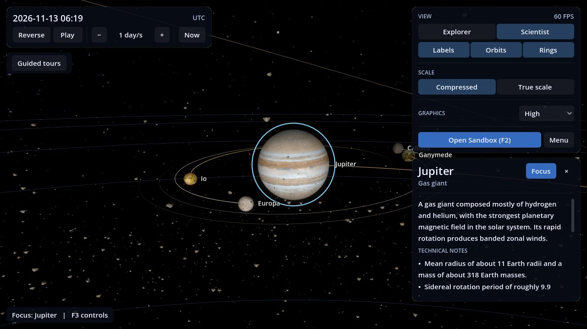
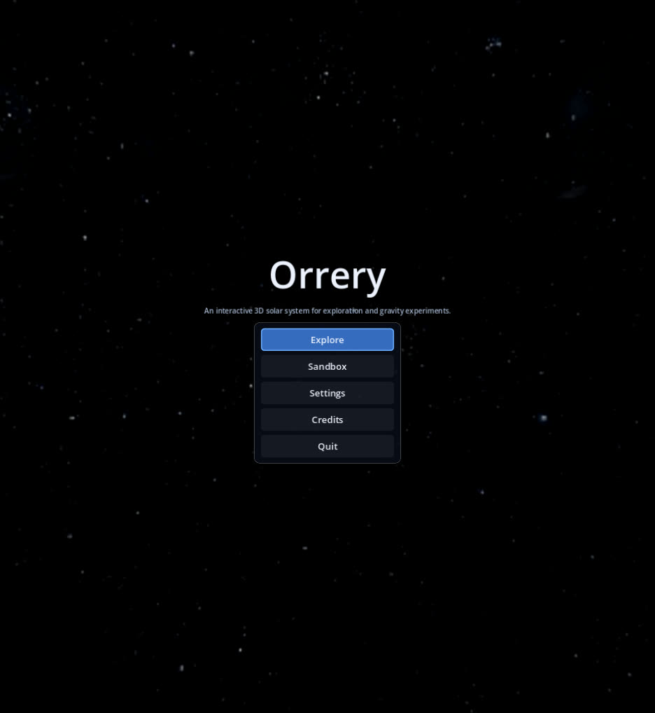
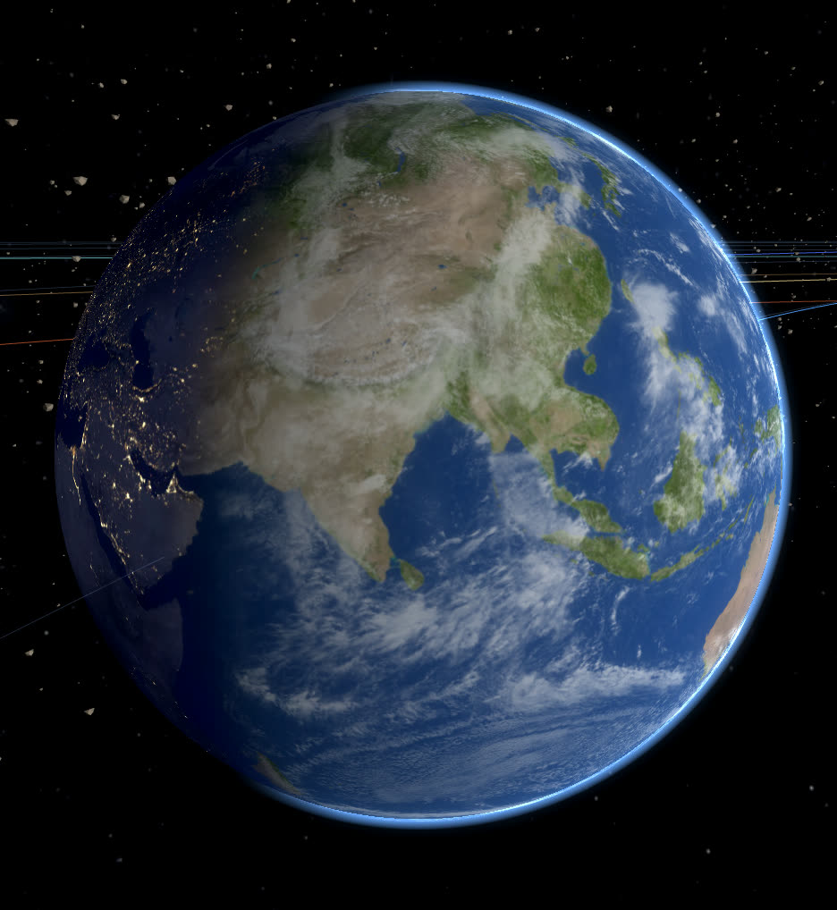
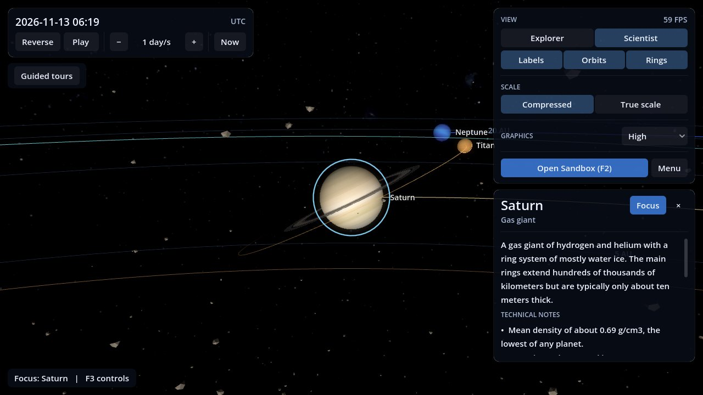
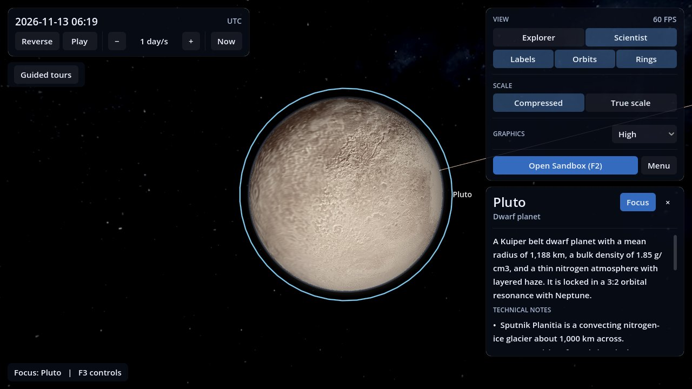
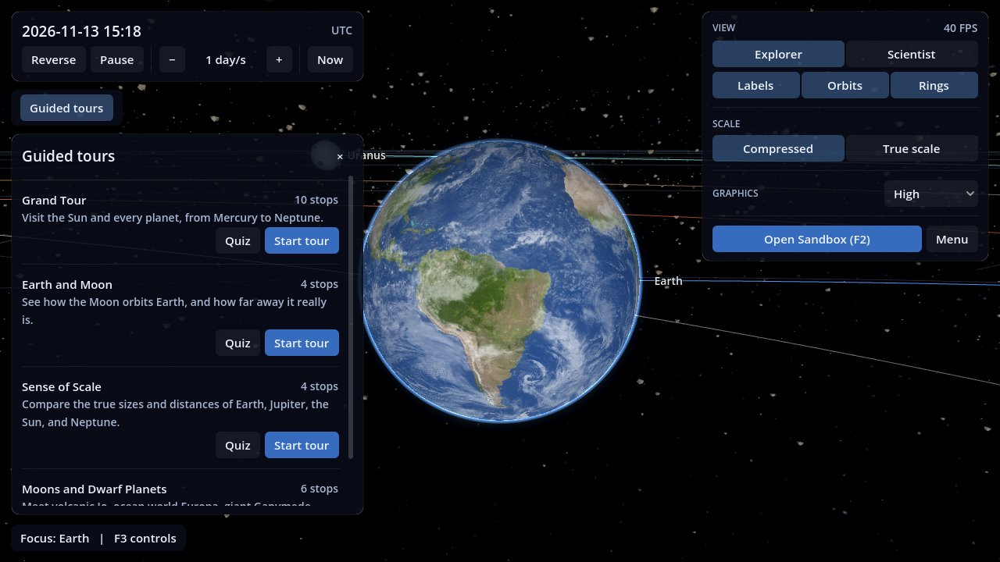
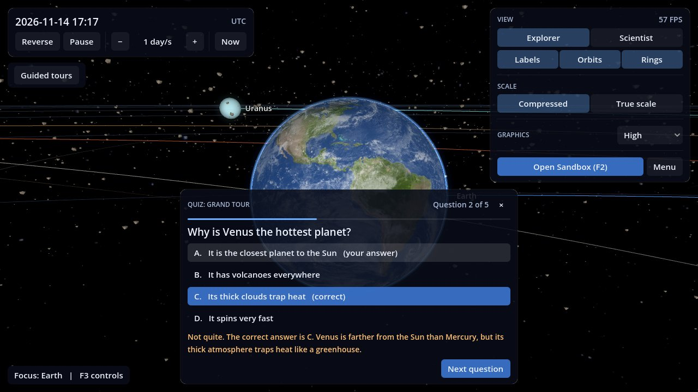
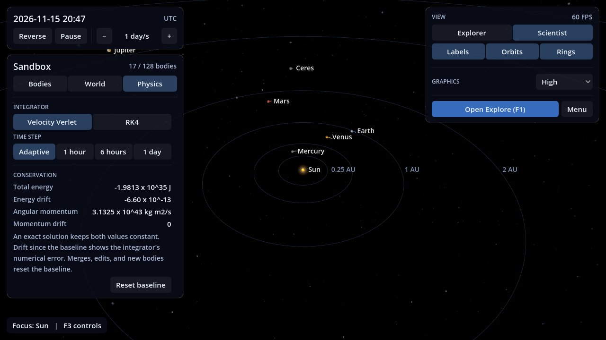

# Orrery

**An interactive 3D solar system for exploration and gravity experiments.**


-555)




Orrery models the Sun, the eight planets, the Moon, the Galilean moons, Titan, Ceres, Pluto, and the main asteroid belt in real time. Explore the system at any date and speed, follow narrated tours, test what you learned with quizzes, or switch to the Sandbox and build your own gravitational systems with a live N-body simulation. Every piece of content is bundled, so the application runs as a single offline executable.

It is aimed at learners from elementary school to university. Every panel switches between two depth levels: **Explorer** for plain language and **Scientist** for full numeric data.

## Contents

- [Features](#features)
- [Screenshots](#screenshots)
- [Getting started](#getting-started)
- [Controls](#controls)
- [Project structure](#project-structure)
- [Technical overview](#technical-overview)
- [Offline tooling](#offline-tooling)
- [Credits and licenses](#credits-and-licenses)
- [Team](#team)

## Features

### Explore

- **Bodies.** The Sun, 8 planets, 6 moons, 2 dwarf planets, and an instanced asteroid belt of up to 10,000 rocks.
- **Accurate orbits.**
  - Planets use JPL Keplerian elements.
  - The Moon uses Meeus mean elements.
  - The Galilean moons use JPL satellite mean elements.
  - Ceres and Pluto use JPL Small-Body Database orbits.
  - Positions of the moons and dwarf planets agree with JPL Horizons to within 0.4°.
- **Time control.** Play, pause, reverse, change the speed, or jump to the current date.
- **Two scales.** A compressed view keeps every world visible. True scale shows real sizes and distances.
- **Body information.** Click any body for a summary, facts, and live orbital data at either depth level.
- **Guided tours.** Four tours: Grand Tour, Earth and Moon, Sense of Scale, and Moons and Dwarf Planets. Each has captions and synthesized voice-over for both levels.
- **Quizzes.** Every tour has a short quiz for each level, with an explanation after each answer. The quiz is offered when a tour ends and can be opened from the tour menu.

### Sandbox

- **Gravity simulation.** Mutual N-body gravity uses Velocity Verlet or RK4, with adaptive or fixed time steps and a per-frame CPU budget.
- **Build systems.**
  - Place a body and drag to launch it.
  - Edit a body's mass, radius, and color, freeze it, or remove it.
- **Collisions.** Bodies that touch merge with conserved mass and momentum. A swept contact test stops fast bodies from passing through each other.
- **Presets.** Solar system, binary star, extra planet, and rogue star flyby. Snapshots save the current state and restore it later.
- **Conservation readouts.** At the Scientist level, total energy and angular momentum are shown with their drift, to illustrate the numerical error of each integrator.

### Application

- **Menus.** A main menu, a pause menu, a credits screen, and settings that persist between sessions.
- **Display and graphics settings.**
  - Window mode and resolution.
  - Low, Medium, or High quality preset, plus a render scale slider.
  - Orbit trail length.
- **Audio settings.** Separate volumes for music, effects, and narration, a music mute, and a voice-over toggle.
- **Mouse and touchpad.** Drag or scroll with two fingers to orbit the focused body, and pinch or use the mouse wheel to zoom. Smooth touchpad scrolling is detected automatically, and the scroll behavior can be set to Auto, Orbit, or Zoom.
- **Controls.** Every action can be rebound. Conflicting bindings are refused, and the on-screen help follows the active keys.
- **Accessibility.**
  - Interface size of 100%, 115%, or 130%.
  - A colorblind-safe orbit palette (Okabe–Ito).
  - Captions are always shown for narration, and nothing flashes.

## Screenshots

| | |
|---|---|
|  |  |
| Main menu | Earth with city lights, clouds, and atmosphere |
|  |  |
| Saturn's rings and the orbit of Titan | Pluto from New Horizons mosaics |
|  |  |
| Guided tours with quizzes | Quiz feedback with explanations |
|  | |
| Sandbox physics panel with conservation readouts | |

## Getting started

### System requirements

| Tier | Specification | Target |
|---|---|---|
| Minimum | 64-bit dual-core CPU, 4 GB RAM, integrated GPU with OpenGL 3.3, 1280 × 720 | 30 FPS on Low |
| Recommended | Laptop from the last 5 years with integrated graphics, 8 GB RAM, 1920 × 1080 | 60 FPS on Medium |
| High | Dedicated GPU | 60 FPS on High |

Supported platforms are Windows 10 and 11, and 64-bit Linux. No installation or internet connection is needed.

### Run from source

1. Install [Godot 4.7.2](https://godotengine.org/download/archive/4.7.2-stable/) (standard build).
2. Open `godot/project.godot` in the editor and press F5, or run this from the repository root:

   ```
   godot --path godot
   ```

### Export builds

Install the Godot 4.7.2 export templates, then run from the repository root:

```
godot --headless --path godot --export-release "Windows" ../builds/windows/Orrery.exe
godot --headless --path godot --export-release "Linux" ../builds/linux/Orrery.x86_64
```

Each build is a single executable with the game data embedded. On Linux, mark it executable with `chmod +x Orrery.x86_64`.

## Controls

These are the default bindings. Every keyboard action can be rebound in **Settings → Controls**, and **F3** shows the current keys in the application.

| Action | Keys |
|---|---|
| Move, down / up | W A S D, Q / E |
| Orbit the focused body | Left drag, or two-finger scroll on a touchpad |
| Zoom | Mouse wheel, pinch, or Ctrl + scroll |
| Look around | Right mouse button + move |
| Flight speed / boost | Shift + scroll / Shift |
| Select body / focus body | Left click / double click or 1 – 0 |
| Next body / free flight | Tab / F |
| Pause, reverse, slower / faster | Space or P, R, `[` / `]` |
| Labels, orbit lines, distance rings | L, O, G |
| Explorer / Scientist level | M |
| Compressed / true scale, jump to now | T, N (Explore) |
| Tour and quiz: previous / next | Left / Right or Enter |
| Remove selected body | Delete or Backspace (Sandbox) |
| Open Explore / Sandbox | F1 / F2 |
| Controls help, hide interface | F3, H |
| Cancel, then pause menu | Esc |

## Project structure

```
orrery/
├── assets/LICENSES.md      Register of every third-party asset and data source
├── docs/PRD.md             Product requirements document
├── godot/                  Godot project
│   ├── core/               Simulation, data catalogs, settings, input, audio (double precision)
│   ├── data/               Bodies, info texts, tours, quizzes, presets, credits (JSON)
│   ├── modes/              Main menu, Explore, Sandbox, shared scene base
│   ├── render/             Renderers, camera, trails, asteroid belt, shaders
│   ├── ui/                 Theme, HUD, panels, menus
│   └── assets/             Textures, music, effects, narration
└── tools/                  Offline generators for narration, audio, and textures
```

## Technical overview

| Area | Approach |
|---|---|
| Precision | Simulation state in double precision. Rendering uses a floating origin, and distant objects are drawn on a depth shell to keep the near and far planes usable at solar system scale |
| Orbits | Analytic Kepler propagation in Explore. Satellite elements are rotated from their Laplace or equator plane into the ecliptic |
| Orientation | IAU pole and prime-meridian models for every body |
| N-body | Velocity Verlet and RK4 with Plummer softening, an adaptive dynamical time step, swept collision detection, and Hill-sphere parent tracking |
| Shaders | Day and night surfaces, Sun surface and halo, atmosphere scattering, clouds, Saturn's rings with an analytic planet shadow, and asteroids whose Keplerian motion runs on the GPU |
| Graphics techniques | GPU instancing, dynamic trail meshes, HDR glow, a panoramic sky, and quality tiers |
| Audio | Separate Music, Effects, and Narration buses. Music ducks while narration plays |

## Offline tooling

All generated assets are committed, so these tools are only needed to regenerate them. Each tool runs with [uv](https://docs.astral.sh/uv/) and has its own README.

| Tool | Output |
|---|---|
| [`tools/tts`](tools/tts) | Tour and welcome narration with Kokoro-82M, voice `af_bella` |
| [`tools/audio`](tools/audio) | Procedural background music and sound effects with fixed seeds |
| [`tools/textures`](tools/textures) | Moon and dwarf planet textures from USGS global mosaics |

## Credits and licenses

- **Textures.**
  - Planets, the Sun, the Moon, the rings, and the sky: [Solar System Scope](https://www.solarsystemscope.com/textures/), CC BY 4.0.
  - Moons and dwarf planets: USGS Astrogeology and NASA mission mosaics, public domain.
- **Orbital and physical data.** NASA JPL Solar System Dynamics, the IAU WGCCRE, and Meeus.
- **Narration.** Synthesized offline with Kokoro-82M (Apache-2.0) through kokoro-onnx (MIT). No speech is synthesized at runtime.
- **Music and sound effects.** Generated by the team.
- **Engine.** [Godot Engine](https://godotengine.org/license), MIT.

Every asset is recorded with its source, author, and license in [`assets/LICENSES.md`](assets/LICENSES.md), and listed on the in-app credits screen.

## Team

Team **Sepak Takraw**. Computer Graphics final project.

| Name | Student ID | Role |
|---|---|---|
| Muhamad Fahry Pratama Putra | 245150207111046 | Team Lead |
| Muhammad Atha Tsaqif | 245150201111002 | Member |
| Muhammad Hafizh Faiqunnabil | 245150201111031 | Member |
| Alexander William Sinjaya | 245150200111044 | Member |
