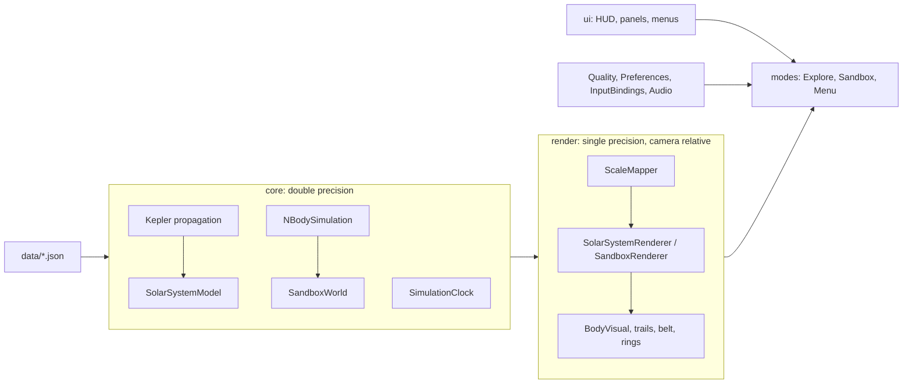
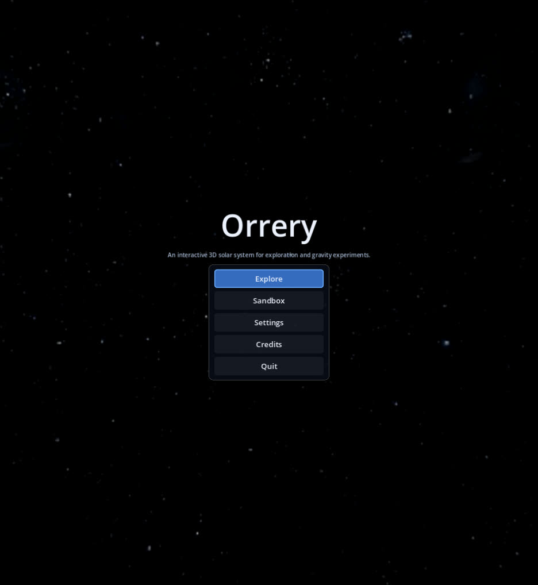
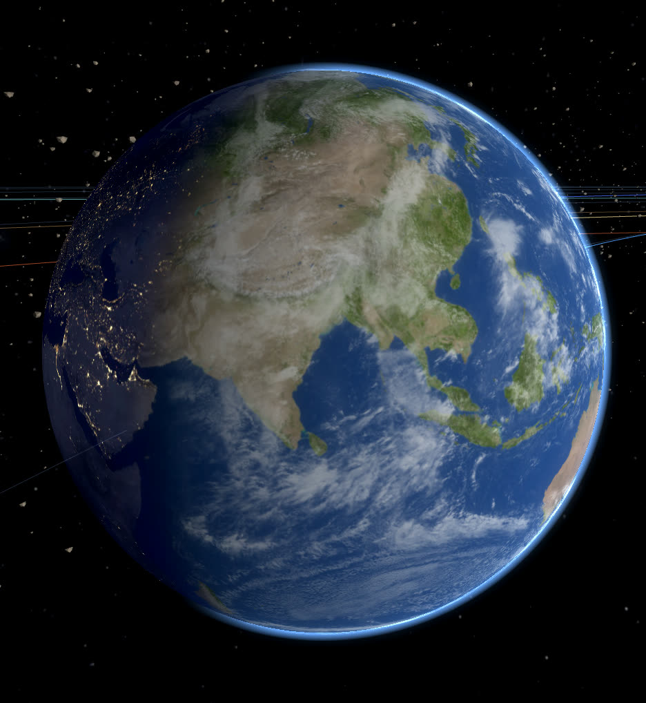
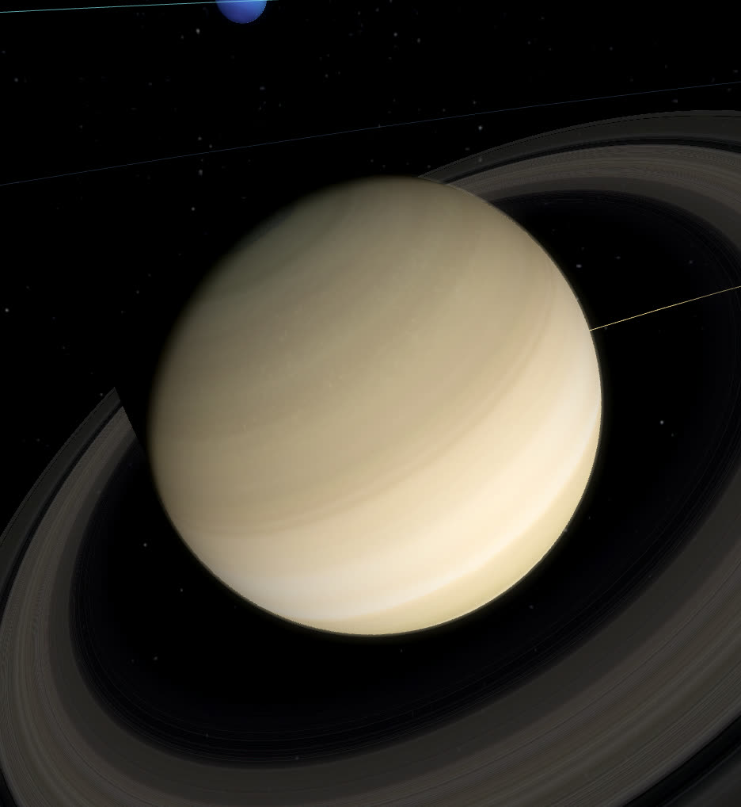
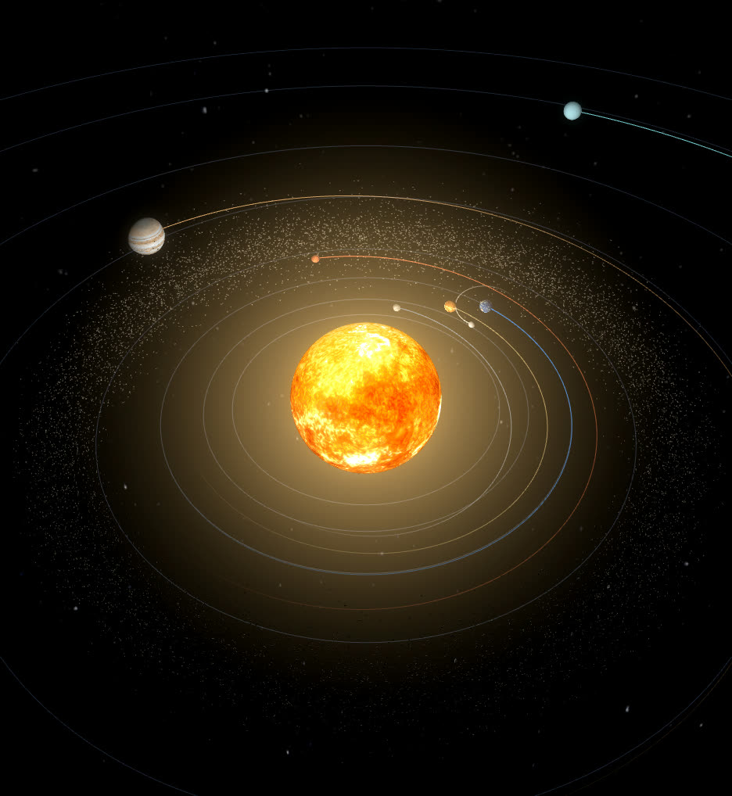
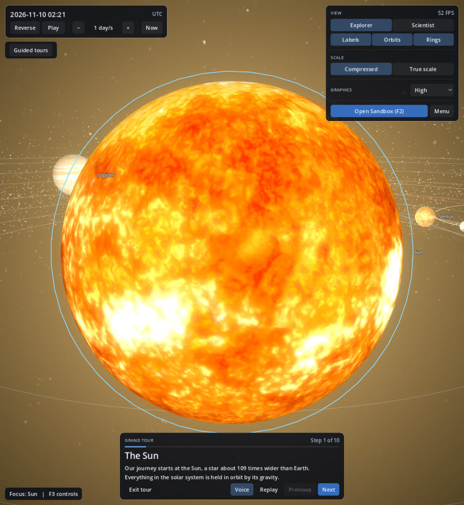
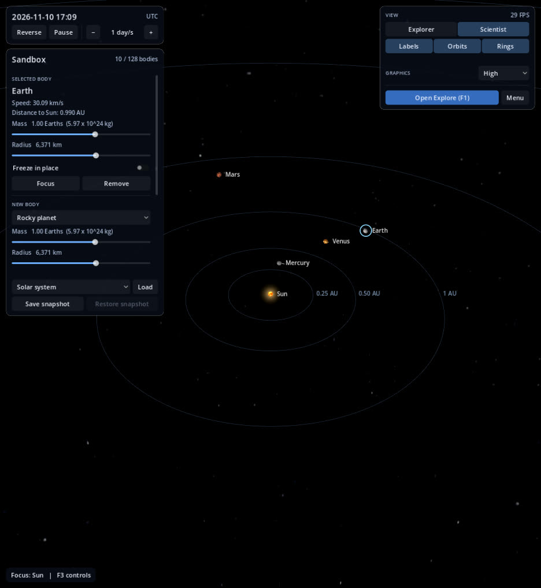
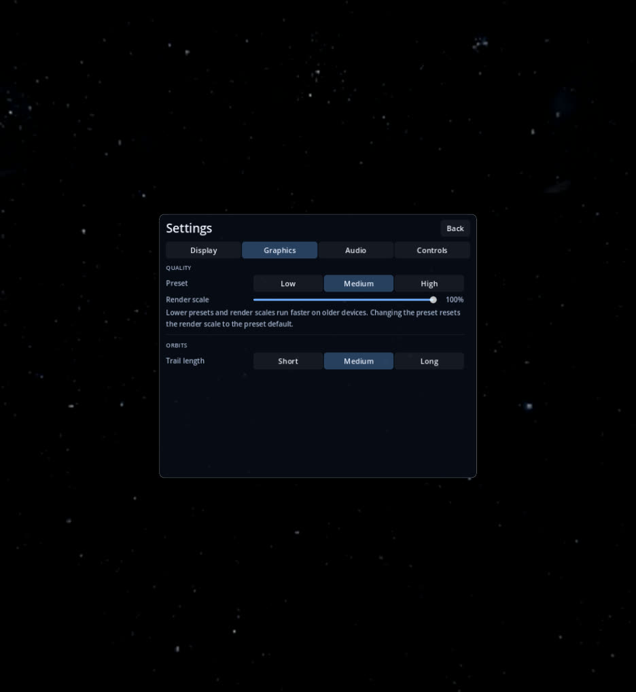
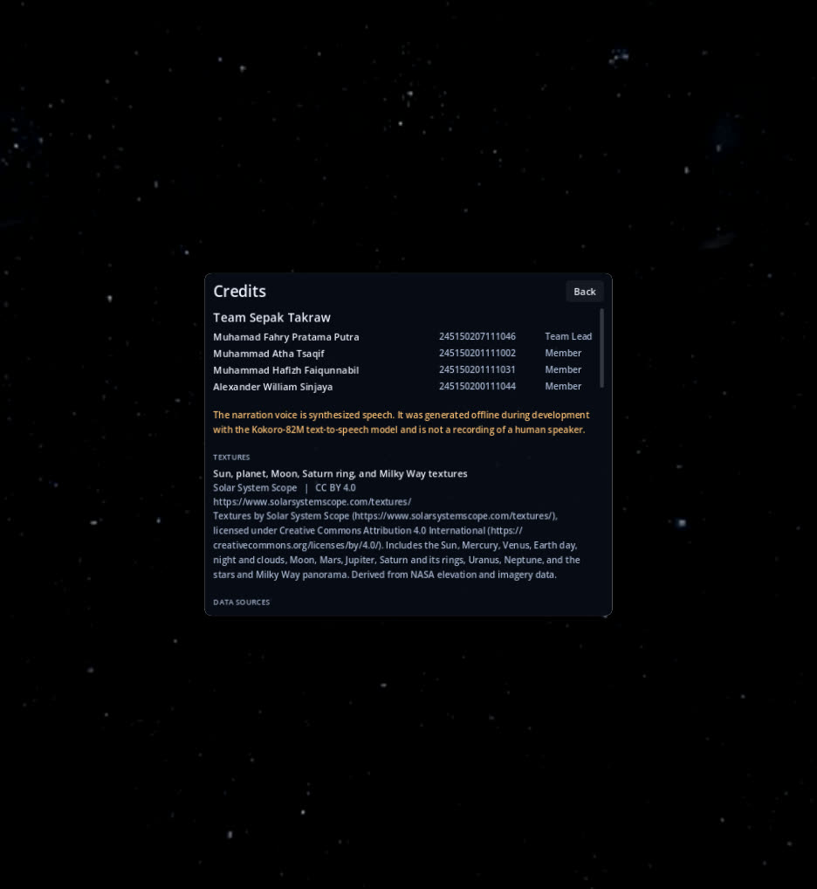

# Orrery: Final Report

| | |
|---|---|
| **Course** | Computer Graphics (Final Project) |
| **Team** | Sepak Takraw |
| **Engine** | Godot 4.7.2, GDScript, Compatibility (OpenGL 3.3) renderer |
| **Platforms** | Windows 10/11 and Linux, x86_64 |

This is a technical draft. The structure will be adjusted once the course specifies the required report format (PRD §14, question 2).

## 1. Summary

Orrery is an interactive real-time 3D model of the solar system with two modes:

- **Explore**: an accurate view of the Sun, the eight planets, the Moon, and the main asteroid belt, with free flight, body information at two depth levels, and guided tours with captions and voice-over.
- **Sandbox**: an N-body gravity simulator. Users can place, launch, edit, freeze, merge, and remove bodies, load presets, and save snapshots.

The application is standalone and fully offline. All data, textures, music, effects, and narration are bundled in a single executable per platform.

| Course requirement | Orrery |
|---|---|
| Interactive computer graphics application | Real-time 3D rendering with free camera, picking, and direct manipulation |
| Purpose | Education, information, entertainment |
| Presentation | 3D |
| Platform | PC: Windows and Linux |
| Credits with names and student IDs | Credits screen in the main menu and pause menu |
| Standalone, no internet | Single-file exports, no network APIs, offline-generated audio |

## 2. Architecture

- **Simulation and rendering are separate.** Simulation state lives in `PackedFloat64Array` and a small double-precision vector type (`DVec3`). Scene nodes never store authoritative positions; renderers read the simulation each frame.
- **Explore** propagates every body analytically from JPL Keplerian elements and their rates, so time can run at any speed, in reverse, or jump to any date at the same cost.
- **Sandbox** integrates mutual gravity numerically (O(n²) pairs), with a per-frame CPU budget.
- **Autoloads** hold cross-scene state: graphics quality, interface preferences, key bindings, and audio. Each persists its own section of `user://settings.cfg`.

## 3. Computer Graphics Techniques

| Technique | Implementation | Files |
|---|---|---|
| Texture mapping | Equirectangular day textures on UV spheres. Earth also uses a night-lights map and a cloud map | `render/body_visual.gd`, `render/shaders/body_surface.gdshader`, `render/shaders/cloud_layer.gdshader` |
| Lighting model | Per-fragment Lambert lighting from the Sun direction, with a smooth day–night terminator, ambient floor, and night-side emission (city lights). The Sun is unlit and emissive with limb darkening | `render/shaders/body_surface.gdshader`, `render/shaders/sun_surface.gdshader` |
| Custom spatial shaders | Sun surface, Sun halo billboard, atmosphere, clouds, Saturn's rings, asteroid belt | `render/shaders/` |
| Atmosphere scattering | Additive shell around the planet. The ray's path length through the shell gives limb brightening. The surface normal at the ray's closest approach decides whether the sample is lit. A forward-scatter term brightens the terminator when looking toward the Sun | `render/shaders/atmosphere.gdshader` |
| Analytic shadows | Saturn's rings test each fragment against the planet sphere along the light direction, giving the planet's shadow on the rings without shadow maps | `render/shaders/planet_ring.gdshader` |
| Alpha blending and draw order | Rings, clouds, atmosphere, halo, and trails use blending with depth writes disabled and explicit render priority (clouds before atmosphere) | `render/body_visual.gd` |
| Post-processing | HDR glow (bloom) on the Sun and bright surfaces, enabled per quality preset | `modes/shared/space_scene.gd` |
| Environment mapping | Milky Way panorama as the sky background | `modes/shared/space_scene.gd` |
| GPU instancing | Up to 10,000 asteroids in one `MultiMesh`. Each instance stores its orbital frame and elements; the vertex shader solves Kepler's equation, applies the scale mapping, and places the rock. The CPU only updates a few uniforms per frame | `render/asteroid_belt.gd`, `render/shaders/asteroid_belt.gdshader` |
| Dynamic mesh generation | Orbit trails are rebuilt every frame with `ImmediateMesh` line strips that fade along their length. Sandbox trails use a ring buffer of past positions | `render/orbit_trail.gd`, `render/sandbox_trail.gd` |
| Procedural meshes | Ring annulus and the asteroid rock (a perturbed icosahedron with flat normals) are generated in code | `render/body_visual.gd`, `render/asteroid_belt.gd` |
| Coordinate transforms | Ecliptic to render axes, IAU pole and prime-meridian orientation for every body, compressed versus true-scale mapping | `core/body_definition.gd`, `render/scale_mapper.gd` |
| Floating origin and depth shell | Positions are made camera-relative in double precision before conversion to float. Objects beyond a distance shell are pulled onto it with their size scaled by the same factor, which keeps the near/far ratio bounded and removes depth fighting at solar-system scale | `render/solar_system_renderer.gd`, `render/sandbox_renderer.gd` |
| Camera systems | Free flight with speed scaled to the distance from the nearest surface, focus-and-follow, and eased flights between bodies with quaternion slerp | `render/camera_rig.gd` |
| Picking and occlusion | Screen picking by angular distance between the view ray and each body's angular radius. Labels are hidden when a nearer body covers them | `render/*_renderer.gd`, `ui/body_labels.gd` |
| Quality scaling | Low/Medium/High presets control sphere tessellation, trail resolution, glow, MSAA, render scale, effect detail, asteroid count, and the sandbox body cap | `core/quality_settings.gd` |

## 4. Simulation

### 4.1 Explore: analytic orbits

Planet positions come from the JPL "Keplerian Elements for Approximate Positions of the Major Planets" (valid 1800–2050), with the Moon's orbit around Earth from Meeus's mean elements. Kepler's equation is solved by Newton iteration in double precision. Because the solution is analytic, reversing time and jumping to a date are exact and cost the same as normal playback.

### 4.2 Sandbox: N-body integration

- **Initial state:** state vectors are derived from the same orbital elements. Earth and the Moon are split about their barycenter, because the published Earth elements describe the Earth–Moon barycenter.
- **Integrators:** Velocity Verlet by default; RK4 is selectable at Scientist level. Both share the same force code, softening, and frozen-body handling.
- **Time step:** adaptive by default. The step is a fraction of the shortest dynamical time $\sqrt{r^3 / G(m_i + m_j)}$ over all pairs. Fixed steps of 1 hour, 6 hours, and 1 day are available to show numerical drift.
- **CPU budget:** each frame gets 5 ms of integration time. When the requested speed cannot be met, the effective speed drops and the HUD says so.
- **Collisions:** contacts use a swept test along each pair's motion during the step, so fast bodies cannot pass through each other between steps. Merges conserve mass and momentum, place the result at the center of mass, and keep the volume: $r = \sqrt[3]{r_1^3 + r_2^3}$.
- **Orbit references:** each body's trail and launch reference is the body whose Hill sphere contains it.

## 5. Audio

- **Narration:** every guided-tour step has voice-over for both depth levels. It is generated offline with Kokoro-82M (Apache-2.0) through kokoro-onnx (MIT), voice `af_bella`. The credits state that the narration is synthesized. Captions are always shown, and voice-over can be turned off on its own.
- **Music and effects:** generated by the team with procedural synthesis (`tools/audio/generate_audio.py`). The generator uses fixed seeds and no third-party samples. The music is rendered on a circular timeline so the loop has no seam.
- **Mixing:** separate Music, Effects, and Narration buses with persisted volumes. Music is ducked while narration plays.

## 6. Application Shell

- **Main menu:** Explore, Sandbox, Settings, Credits, Quit, over a drifting Milky Way background. It can be used with the keyboard alone.
- **Settings:**
  - Display: window mode and resolution.
  - Graphics: quality preset, a render scale slider from 50% to 100%, and orbit trail length.
  - Audio: volumes, music mute, and voice-over.
  - Controls: rebinding for every action, with a reset to defaults.

  Everything is saved to `user://settings.cfg`.
- **Credits:** the team with student IDs, third-party asset attributions (CC BY 4.0 textures, data sources, Kokoro), the synthesized-narration disclosure, and the Godot Engine license.
- **Pause menu:** Esc opens it in both modes once nothing else is open or selected. It pauses the simulation and offers Resume, Settings, Credits, Main menu, and Quit.

## 7. Verification

All measurements were taken on the development laptop: Intel Core i5-12450HX and Mesa on the Intel UHD Graphics (ADL-S GT0.5) integrated GPU. This is the weakest Alder Lake iGPU; the session could not load the dedicated GPU's driver.

### 7.1 Simulation checks

These were run as throwaway scripts against the engine code:

| Check | Result |
|---|---|
| Head-on merge of $10^{24}$ kg and $5 \times 10^{23}$ kg bodies at ±10 km/s | One body, mass $1.5 \times 10^{24}$ kg, velocity 3.3333 km/s (momentum conserved), radius 5336.8 km = $\sqrt[3]{5000^3 + 3000^3}$ |
| 200 km/s body crossing a planet with a 1-day fixed step | Merged; no tunneling |
| Energy drift, Sun and eccentric planet, 10 years, 1-day step | Velocity Verlet $7.3 \times 10^{-7}$; RK4 $4.8 \times 10^{-8}$ |
| Each preset for 6 simulated years | Stable. The binary-star planet stays at 1.57 AU; the rogue star's closest approach to the Sun is 17.7 AU |
| Snapshot save and restore | Positions identical to $2.4 \times 10^{-7}$ km; catalog definitions, frozen state, and date preserved |

### 7.2 Interface checks

A scripted run drove the real scenes and confirmed:

- Key rebinding applies, persists, and resets.
- The render scale applies, and changing the preset resets it.
- The welcome clip plays.
- Tour voice follows step and depth level, and music ducks by 8 dB during narration.
- With voice-over off, narration stops and captions stay.
- The Esc order works: tour, then selection, then pause menu. Pausing freezes the simulation.
- Main menu is reachable from the pause menu.

### 7.3 Performance (low-spec approximation, §6.1)

Conditions: 1280×720, vsync off, limited to two CPU cores with `taskset -c 0,1`, on the integrated GPU. Each value is the average over 8 seconds after a 2-second warm-up. The sandbox is filled to the preset's body cap with time running at 1 day/s.

| Preset | Explore, near Earth | Explore, system overview | Sandbox at body cap |
|---|---|---|---|
| Low | 172 FPS | 195 FPS | 147 FPS (32 bodies) |
| Medium | 62 FPS | 71 FPS | 79 FPS (64 bodies) |
| High | 44 FPS | 47 FPS | 55 FPS (128 bodies) |

- **Minimum target** (30 FPS on Low): met, with a wide margin.
- **Recommended target** (60 FPS on Medium): met at 1280×720 on this iGPU. 1920×1080 was not measured.
- **High target:** assumes a dedicated GPU, which could not be tested in this session.
- **Sandbox speed:** at the Medium and High caps, the HUD reports that the simulation speed is limited. This is the CPU budget working as designed.

### 7.4 Builds and offline operation

| Build | Size | Check |
|---|---|---|
| Linux `Orrery.x86_64` | 96 MB, single file with embedded PCK | Ran to the main menu inside a network namespace with no network access (`unshare -rn`) |
| Windows `Orrery.exe` | 132 MB, single file with embedded PCK | Ran to the main menu under Wine 64-bit with the same renderer. Not yet run on native Windows |

The source contains no networking APIs (no `HTTPRequest`, `HTTPClient`, TCP, UDP, WebSocket, or ENet). All narration, music, and effects are pre-generated and bundled.

## 8. Screenshots

| | |
|---|---|
|  |  |
| Main menu | Earth: day/night terminator, city lights, clouds, atmosphere |
|  |  |
| Saturn's rings with the planet's shadow | Inner system with the instanced asteroid belt |
|  |  |
| Guided tour with caption, voice, and replay controls | Sandbox at Scientist level |
|  |  |
| Settings | Credits with student IDs and attributions |

## 9. Course Deliverable Checklist

| Item | Status |
|---|---|
| Interactive computer graphics application | Done |
| Purpose: education, information, entertainment | Done |
| Presentation: 3D | Done |
| Platform: PC (Windows, Linux) | Linux build verified natively; Windows build verified under Wine, native check pending |
| Credits screen with names and student IDs | Done (main menu and pause menu) |
| Standalone, no internet connection required | Done |
| Technologies documented in the report | This document |

## 10. Known Limitations

- The Windows build has not yet been run on a native Windows machine.
- The High preset's 60 FPS target, and 1920×1080 on Medium, have not been measured on the intended hardware.
- Not implemented (P1/P2 items, cut per PRD §11.1):
  - F-06: additional moons and dwarf planets.
  - F-15: quiz.
  - F-27: energy and angular momentum readouts.
- Not implemented from PRD §8:
  - Normal and specular maps.
  - Sphere tessellation by distance; tessellation is fixed per quality preset instead.
- Forcing the application to quit while audio is playing (for example with `--quit-after`) can print an engine warning about leaked audio playback objects. Closing the window or using Quit stops audio first and exits cleanly.
